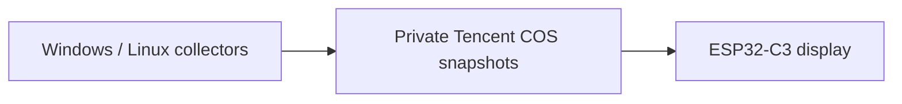

**English** · [简体中文](README.zh_CN.md)

# Cyber Meal Card

A pocket dashboard for AI quotas, account balances and points, built for the
FoloToy AI Passport. Check your accounts on a 240 × 320 screen with a unified
Deep Ocean Blue interface.

Computer collectors gather the data and publish private Tencent COS snapshots.
The ESP32-C3 reads those snapshots; provider credentials stay on the computers.

## What it shows

| Service | Displayed information |
| --- | --- |
| ChatGPT | Remaining quota, reset countdowns, available reset credits and the nearest known credit expiry |
| ClinePass | Five-hour, weekly and monthly remaining quotas and reset countdowns |
| DeepSeek | Account, topped-up and granted balances, including accounts with two currencies |
| TokenHub | Estimated remaining monthly allocation, monthly spending and today's spending |
| TeleAgent | Points balance, points spent today and points added today, across all clients and models |

ChatGPT reset credits are distinct from paid purchases or recharge counts.
Unavailable fields stay unknown. The expiry shown is the nearest known expiry
among available credits. Displayed collection times and expiry dates use UTC+8.

## Collection and synchronization



- Enable the provider plugins you need in local configuration. Add new plugins
  under `collector/plugins/`; standard quota, balance and points fields share the
  existing display logic.
- Each computer gets its own collector ID and COS objects. Stable account IDs
  let the display combine duplicate accounts and select the newest observation.
  Use the same explicit `account_id` across machines when the provider needs one.
- Collectors retain both a compact display summary and richer private business
  details, allowing future firmware to use additional fields.
- Collection and device synchronization default to five-minute intervals.
  Old observations retain their source timestamps and show stale/error states.

## Get started

```sh
git clone https://github.com/crazyqin/cyber-meal-card.git
cd cyber-meal-card
```

### Linux collector, without Docker

From the repository root on a computer with Python 3, create a public deployment
bundle containing source and installation scripts:

```sh
python tools/package_collector_linux.py --output build/deployment/ai-collector-linux-public.tar.gz
```

Copy that archive to the Linux computer, then run:

```sh
tar -xzf ai-collector-linux-public.tar.gz
cd ai-collector-linux
bash install.sh
bash collector.sh configure
bash collector.sh login
bash collector.sh check
bash collector.sh start
```

Supports x86_64 and ARM64 with glibc 2.28 or newer. The installer downloads and
verifies pinned Python, Node.js and Codex runtimes. Configure your own COS access
and enable the desired providers. `login` authenticates ChatGPT; TokenHub and
TeleAgent use separate local sessions. See the [Linux deployment guide](collector/linux/README.md)
for prerequisites, session setup, upgrades, logs and optional systemd integration.

### Windows collector

With Python 3 available, run these commands from the repository root:

```powershell
cd collector
python -m venv .venv
.venv/Scripts/python -m pip install -r requirements.txt
.venv/Scripts/python collect.py init --providers chatgpt
.venv/Scripts/python collect.py configure
.venv/Scripts/python collect.py doctor
.venv/Scripts/python collect.py run --once
```

For ChatGPT, install Codex CLI and sign in with the ChatGPT account first. Configure
COS before uploading. Use `start.cmd` for continuous collection and `configure.cmd`
to change modules or credentials. TokenHub additionally needs Node.js and its WAF
dependencies. See the [collector guide](collector/README.md) and
[provider setup instructions](docs/development/subscription-viewer.md).

## Firmware and controls

Hardware: **ESP32-C3, 8 MB Flash, no PSRAM, 240 × 320 display, three buttons**.

1. Prepare [ESP-IDF 5.5.3](docs/development/engineering/environment-setup.md).
2. Create local `collector/config.local.json` and `collector/secrets.local.json`
   with your COS settings. Firmware builds automatically embed that configuration;
   `device_cos` can provide separate read-only access.
3. Optionally put Wi-Fi `ssid` and `pass` fields in the local `key.txt` one directory
   above the repository. Builds embed these defaults for a fresh device. Saved
   device settings take precedence; the setup page allows later changes.
4. From the repository root in the activated ESP-IDF environment, run
   `bash tools/validate.sh` to test, build and verify the merged firmware image.

The verified merged image is flashed at `0x0` and can reset stored configuration.
See [firmware setup and flashing](docs/development/subscription-viewer.md) for the
matching layout and application-only update procedure.

| Control | Action |
| --- | --- |
| Up / Down, short press | Previous / next account |
| OK, short press | Request synchronization |
| OK, long press | Open / close the Wi-Fi and COS setup hotspot |
| Up, long press | Toggle automatic page rotation |
| Down, long press | Reconnect Wi-Fi |

## Private configuration

Keep `key.txt`, `*.local.json`, account sessions, collected data and logs private.
They are ignored by Git. Examples contain placeholders and tests use synthetic
fixtures. Firmware and ELF files built with Wi-Fi/COS defaults contain credentials;
keep those artifacts and any deployment package containing COS credentials private.

## Documentation and development

- [Full application, provider and data-format guide](docs/development/subscription-viewer.md)
- [Documentation index](docs/README.md)
- [Build and test](docs/development/engineering/build-and-test.md)
- [Hardware guide](docs/hardware-design/AI_HARDWARE_DEVELOPMENT_GUIDE.md)
- [Agent instructions](AGENTS.md)

Run `bash tools/validate.sh --static` for repository checks and offline host tests.
Firmware changes also require the full gate. Builds and host tests are separate
from on-device acceptance.

Based on [FoloToy AI Passport](https://gitee.com/FoloToy/ai-passport), with its BSP
and hardware documentation retained. Project code uses the [MIT license](LICENSE);
fonts and vendored components retain their [respective licenses](assets/README.md).
