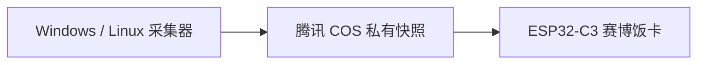

**简体中文** · [English](README.md)

# 赛博饭卡

把 AI 额度、账户余额和积分放进一张随身小卡片。基于 FoloToy AI Passport，
使用 240 × 320 屏幕和统一的深海蓝界面，随时查看各账号的使用情况。

电脑上的采集器负责获取数据，上传腾讯 COS 私有快照；ESP32-C3 读取快照进行展示，
各平台的 Key 和登录凭据保存在采集电脑上。

## 能看什么

| 平台 | 展示内容 |
| --- | --- |
| ChatGPT | 剩余额度、重置倒计时、可用重置次数、已知最近到期的可用重置机会 |
| ClinePass | 5 小时、每周、每月剩余额度及重置倒计时 |
| DeepSeek | 账户余额、充值余额、赠送余额，支持同时展示双币种 |
| TokenHub | 本月估算剩余额度、本月消费、今日消费 |
| TeleAgent（天翼 AI 星辰） | 全部调用端、全部模型的积分余额、今日消耗积分、今日新增积分 |

ChatGPT 的可用重置机会与付费购买、充值次数是不同指标。接口未提供的数据保持未知；
到期时间展示可用机会中已知最近到期的一次。采集时间和到期日期统一使用北京时间。

## 采集与同步



- 按需启用独立采集模块。新增平台放在 `collector/plugins/`，通用额度、余额、积分字段
  复用现有展示逻辑。
- 每台电脑自动生成独立采集器 ID，上传各自的 COS 对象。相同账号通过稳定身份合并，
  选择源采集时间较新的结果；需要手动指定身份的平台，在各台电脑使用相同 `account_id`。
- 同时保存供固件展示的精简摘要和更完整的私有业务明细，后续固件可以使用更多字段。
- 默认每五分钟采集和同步。旧数据保留原采集时间，过期或失败时明确显示状态。

## 开始使用

```sh
git clone https://github.com/crazyqin/cyber-meal-card.git
cd cyber-meal-card
```

### Linux 采集器，无需 Docker

在有 Python 3 的电脑上，从仓库根目录生成包含源码和安装脚本的公开部署包：

```sh
python tools/package_collector_linux.py --output build/deployment/ai-collector-linux-public.tar.gz
```

把压缩包复制到 Linux 电脑，再执行：

```sh
tar -xzf ai-collector-linux-public.tar.gz
cd ai-collector-linux
bash install.sh
bash collector.sh configure
bash collector.sh login
bash collector.sh check
bash collector.sh start
```

支持 x86_64、ARM64，要求 glibc 2.28 或更新版本。安装器会下载并校验固定版本的
Python、Node.js 和 Codex 运行时。配置自己的 COS 权限并启用所需模块；`login` 用于
ChatGPT 登录，TokenHub 和 TeleAgent 分别保存本机会话。安装依赖、会话设置、升级、
日志和可选 systemd 配置见 [Linux 部署说明](collector/linux/README.zh_CN.md)。

### Windows 采集器

准备好 Python 3 后，从仓库根目录执行：

```powershell
cd collector
python -m venv .venv
.venv/Scripts/python -m pip install -r requirements.txt
.venv/Scripts/python collect.py init --providers chatgpt
.venv/Scripts/python collect.py configure
.venv/Scripts/python collect.py doctor
.venv/Scripts/python collect.py run --once
```

采集 ChatGPT 前需安装 Codex CLI，并使用对应 ChatGPT 账号登录；上传前先配置 COS。
双击 `start.cmd` 持续采集，`configure.cmd` 调整模块和凭据。TokenHub 还需要 Node.js
及对应 WAF 依赖，具体步骤见[采集器说明](collector/README.zh_CN.md)和
[各平台配置说明](docs/development/subscription-viewer.zh_CN.md)。

## 固件与操作

硬件：**ESP32-C3、8 MB Flash、无 PSRAM、240 × 320 屏幕、三个实体按键**。

1. 准备 [ESP-IDF 5.5.3 环境](docs/development/engineering/environment-setup.zh_CN.md)。
2. 在本地 `collector/config.local.json` 和 `collector/secrets.local.json` 中配置 COS，
   构建固件时自动内置；可通过 `device_cos` 指定独立的只读权限。
3. 如需内置 Wi-Fi，在仓库上一级目录的本地 `key.txt` 中填写 `ssid` 和 `pass`。
   新设备启动时使用这些默认值；设备已保存的配置优先，之后可通过设置页修改。
4. 在激活 ESP-IDF 的环境中，从仓库根目录运行 `bash tools/validate.sh`，完成测试、
   固件构建和合并镜像校验。

验证后的完整合并镜像从 `0x0` 烧录，可能重置设备保存的配置。匹配分区布局和应用单体
更新方式见[固件配置与烧录说明](docs/development/subscription-viewer.zh_CN.md)。

| 按键 | 操作 |
| --- | --- |
| 上／下短按 | 切换上一个／下一个账号 |
| 确定短按 | 请求同步 |
| 确定长按 | 打开／关闭 Wi-Fi 和 COS 设置热点 |
| 上键长按 | 开启／关闭自动轮播 |
| 下键长按 | 重连 Wi-Fi |

## 私有配置

`key.txt`、`*.local.json`、账号登录会话、采集数据和日志均应保密，已加入 Git 忽略规则。
示例配置使用占位符，测试使用虚构数据。内置 Wi-Fi／COS 配置的固件与 ELF 含有凭据；
这些产物以及包含 COS 凭据的部署包应保持私有。

## 文档与开发

- [完整应用、平台配置与数据协议](docs/development/subscription-viewer.zh_CN.md)
- [文档导航](docs/README.zh_CN.md)
- [构建与测试](docs/development/engineering/build-and-test.zh_CN.md)
- [硬件指南](docs/hardware-design/AI_HARDWARE_DEVELOPMENT_GUIDE.zh_CN.md)
- [Agent 开发规范](AGENTS.zh_CN.md)

运行 `bash tools/validate.sh --static` 进行仓库检查和离线主机测试。固件变更还需要通过
完整验证；构建和主机测试与真机验收分别报告。

本项目基于 [FoloToy AI Passport](https://gitee.com/FoloToy/ai-passport)，保留其 BSP 和
硬件文档。项目代码采用 [MIT 许可证](LICENSE)，字体和第三方组件保留
[各自许可证](assets/README.zh_CN.md)。
